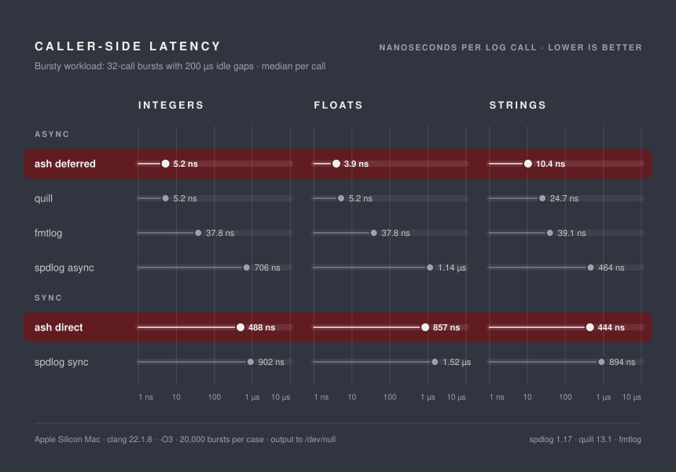
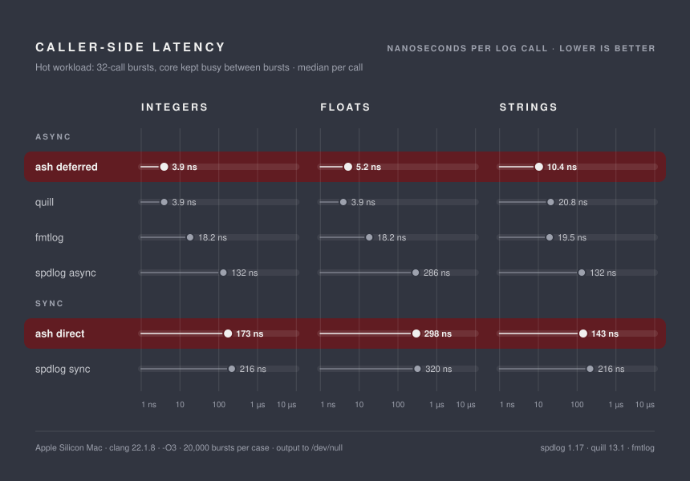

# ash-cpp

This is a C++26 diagnostic library built on modules, designed for speed and customization. This library features native alert modals and loggers.

Check out how it compares to similar libraries in the [Benchmark](#benchmarks) section.

## Requirements

- A C++26 compiler with C++ modules support. Developed and tested with clang 22.1.8 on macOS.
- CMake 4.0 or newer, with a generator that supports C++ modules (the presets use Ninja Multi-Config).

## Getting started

Add ash to your build and link against `ash::ash` (shared) or `ash::ash-static`:

```cmake
add_subdirectory( external/ash )
target_link_libraries( my_app PRIVATE ash::ash )
```

Then import the module:

```c++
import ash;

auto main( ) -> int
{
   ash::Logger logger{ ash::policy::deferred_unsync };
   logger.info( "hello from {}", "ash" );
}
```

```
[14:20:31] [INFO] [ash] at /path/to/main.cpp:6:17
hello from ash
```

## Logging

The logging part of the library allows much customization through policy classes. In the deferred mode, the log dispatcher is designed to be as quick as possible on the caller thread.

Every signal method (`trace`, `debug`, `info`, `warning`, `error`, `fatal`) takes a format string and its arguments, and returns a handle. The entry is written when the handle is destroyed, which for a plain call is at the end of the statement. That lets modifiers refine the entry first:

| Modifier | Effect |
|---|---|
| `.when( condition )` | Write only if the condition holds. Several conditions combine with *and*. |
| `.once( )` | Write only the first time this call site is reached. |
| `.at_most( n )` | Write at most `n` times from this call site. |
| `.every( n )` | Write every n-th time this call site is reached, for sampling hot loops. |
| `.throttle( interval )` | Write at most once per interval from this call site. |

Usage snippet below:
```c++
logger.trace( "state {}", state ).when( verbose );
logger.error( "retrying {}", attempt ).at_most( 3 );
logger.info( "fps {}", fps ).throttle( std::chrono::seconds{ 1 } );

logger.info( "frame {} took {:.2f} ms", frame, ms );
logger.warning( "missing asset {}", name ).once( );
logger.debug( "tick {}", tick ).every( 100 );
```

Call-site counters only advance for entries that pass `when` and the signal filter, so a filtered-out entry never uses up a `once`.

> [!WARNING]
> The handle references its arguments rather than copying them. Storing a handle (`auto&& h = logger.info( ... )`) delays the write until the handle is destroyed, so every argument must outlive it.

The call site (file, line, column, function) is captured automatically. A wrapper can log on behalf of another location by passing it first:

```c++
auto log_from( std::source_location const& location, int value ) -> void
{
   logger.info( { location, "from wrapper {}" }, value );
}
```

## Benchmarks

Time the calling thread spends inside one log call, compared with [spdlog](https://github.com/gabime/spdlog) 1.17.0, [quill](https://github.com/odygrd/quill) 13.1.0 and [fmtlog](https://github.com/MengRao/fmtlog). Lower is better.





### Method

- **Measured:** time spent in the logging call on the calling thread, averaged over bursts of 32 calls. Backend formatting and I/O happen elsewhere and are not included.
- **Messages:** `"message number {} of {} ({})"` with three integers, `"x={:.3f} y={:.3f} z={:>10.2e}"` with three doubles, and `"{} says {} to {}"` with a string literal, a `std::string` and a `std::string_view`.
- **Runs:** 20,000 bursts per case after a 2,000-call warm-up, with a 200 µs pause between bursts so no queue ever fills. *Bursty* sleeps through the pause, like an application that logs in spurts. *Hot* busy-waits, keeping caches and clocks warm.
- **Output:** every logger writes the same prefix (time with microseconds, level, logger name, file and line) to `/dev/null`.
- **Setup:** Apple Silicon Mac, clang 22.1.8, `-O3 -DNDEBUG`, C++26. Each library in its default configuration.

The timer ticks every 41.7 ns, which is about 1.3 ns per call over a burst, so values within a couple of nanoseconds are a tie. Synchronous loggers vary more between runs than asynchronous ones.


## Features

- **Two dispatch modes.** *Direct* formats and writes on the calling thread. *Deferred* copies the arguments into a lock-free ring and formats them on a worker thread.
- **Compile-time checked formats.** Message formats are checked like `std::format_string`, and the title format is parsed at compile time, so a typo in either is a compile error.
- **Call-site modifiers.** `when`, `once`, `at_most`, `every` and `throttle` chain onto any log call.
- **Cheap timestamps.** Entries are stamped with the CPU tick counter and converted to wall-clock time off the hot path.
- **Policies, not flags.** Thread safety (`sync` / `unsync`) and dispatch (`direct` / `deferred`) are compile-time policies, so the unsynchronized path carries no locking code at all.
- **Native modal dialogs** for assertions and fatal errors (macOS).


## Logging


### Filtering

```cpp
logger.filter_gt_eq( ash::Signal::warning ); // only warning, error and fatal
logger.clear_filter( );
```

## Dispatch policies

| | `ash::policy::direct` | `ash::policy::deferred` |
|---|---|---|
| Where formatting happens | Calling thread | Worker thread |
| Caller cost | Formatting and I/O | Copying the arguments (4 to 10 ns) |
| Entries dropped? | Never | When the ring is full |
| Written before a crash? | Yes | No, queued entries are lost |
| Long messages | Truncated past 512 bytes | String arguments clipped to fit a 205-byte slot |
| Argument types | Anything with a `std::formatter` | Types with an `ash::traits::Codec` |

Prefer **direct** when every entry must reach the sink, such as error and fatal paths, or when logging is sparse. Prefer **deferred** when caller latency matters more than delivery, such as a game loop or a request handler logging in bursts.

The deferred ring holds 256 entries (64 KB) by default. The worker never needs to be woken: it polls, sleeping 100 µs between checks when idle, so a log call never costs a system call. A burst larger than the ring that arrives while the worker sleeps drops the excess. Both values are policy members (`pool_size`, `poll_interval`) and can be raised in a custom policy.

## Access policies

- `ash::policy::unsync`: no locking at all. Use one logger per thread.
- `ash::policy::sync`: a logger can be shared between threads. Locks cover only the state that is actually shared, never a whole log call:
  - **Direct:** the message is formatted on the calling thread before any lock; only the write to the stream is serialized.
  - **Deferred:** no lock on the logging path. Each thread gets its own ring, and the worker merges them by timestamp, so logging threads never contend. Entries from one thread keep their order; across threads they are ordered by tick, so two calls on different threads less than one tick apart (~42 ns on Apple Silicon) may swap.
  - **Deferred, ordered** (`ash::policy::deferred_ordered_sync`): entries from every thread are written in exact call order. All threads share one lock-free ring, and claiming a slot is one atomic operation, which contends when several threads log at once.
  - **Call-site modifiers** (`once`, `at_most`, `every`, `throttle`) take a separate lock, only when they are used.

## Choosing policies

Pass a dispatch policy and an access policy, or one of the presets that bundles them:

```cpp
ash::Logger a{ ash::policy::deferred, ash::policy::unsync };
ash::Logger b{ ash::policy::deferred_unsync }; // same as a
```

The presets are `direct_sync`, `direct_unsync`, `deferred_sync`, `deferred_unsync` and `deferred_ordered_sync`. A custom policy is combined the same way, e.g. `ash::Logger logger{ MyDeferred{}, ash::policy::sync }`.

## Configuration

Pass a `WriteConfig` as the logger's last argument:

```cpp
ash::Logger logger{ ash::policy::deferred_unsync, {
   .identity = "render",
   .title_format = "[{TIME:HH:MM:SS.mmm}] [{SIG:us}] [{ID}] {FUNCTION}",
   .trailer_content = "\n",
} };
```

| Field | Default | Meaning |
|---|---|---|
| `identity` | `"ash"` | Logger name, shown by `{ID}`. |
| `log_stream` | `std::clog` | Stream for `trace` through `warning`. |
| `err_stream` | `std::cerr` | Stream for `error` and `fatal`. |
| `title_injection` | `per_block` | Whether to write a title line before each entry (`none` or `per_block`). |
| `title_format` | `"[{TIME:%H:%M:%S}] [{SIG:u}] [{ID}] at {PATH}:{LINE}:{COLUMN}"` | Title layout, parsed at compile time. |
| `trailer_content` | `"\n\n"` | Text written after each entry. |

### Title keywords

| Keyword | Expands to |
|---|---|
| `{TIME}` | Timestamp. `{TIME:HH}`, `HH:MM`, `HH:MM:SS`, `HH:MM:SS.mmm` and `HH:MM:SS.uuuuuu` use a fast path; any other `std::chrono` spec (e.g. `{TIME:%Y-%m-%d}`) also works. |
| `{SIG}` | Severity. `{SIG:u}` uppercase, `{SIG:s}` short form, `{SIG:us}` both. |
| `{ID}` | The logger's `identity`. |
| `{PATH}`, `{LINE}`, `{COLUMN}`, `{FUNCTION}` | The call site. |

Use `{{` and `}}` for literal braces. An unknown keyword or malformed spec fails to compile.

## Logging your own types with the deferred dispatcher

The deferred dispatcher copies arguments into its ring through `ash::traits::Codec`. Arithmetic types, enums, `void*`, and strings (`std::string`, `std::string_view`, C strings and char arrays) work out of the box. String arguments are copied, so nothing in a queued entry refers back to the caller's storage. For other types, specialize `ash::traits::Codec`; the requirements are documented on its primary template.

## Modal dialogs

On macOS, ash can raise a native dialog, for example from an assertion handler:

```cpp
auto const choice = ash::Modal{ "Assertion" }
                       .set_signal( ash::Signal::debug )
                       .with_desc( ash::Description::as_header( "Log manager needs a default property." ) )
                       .with_desc( ash::Description::as_body( "No default sink is configured." ) )
                       .with_choice( ash::Choice::as_master( "Ignore", 0 ) )
                       .with_choice( ash::Choice::as_cancel( "Exit", 1 ) )
                       .open( );
```

## Build options

| Option | Default | Effect |
|---|---|---|
| `ASH_ENABLE_EXCEPTIONS` | `OFF` | Build with exceptions. Applied publicly, since module interfaces must match their importers. |
| `ASH_ENABLE_RTTI` | `OFF` | Build with RTTI. Applied publicly for the same reason. |

The repository ships `debug` and `release` CMake presets.

## License

See [LICENSE](LICENSE).
